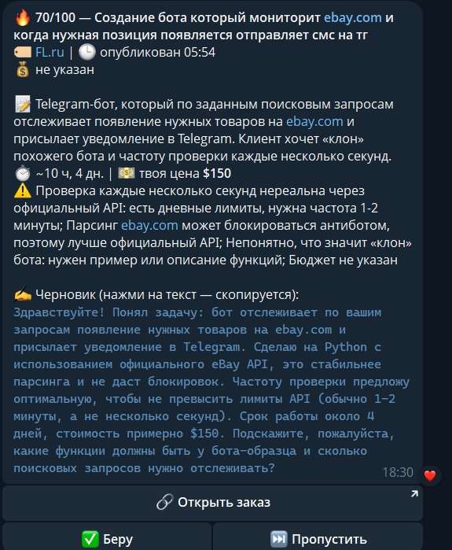
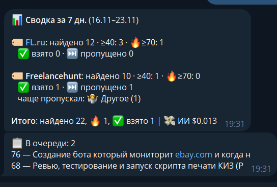
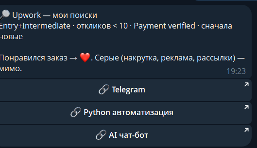
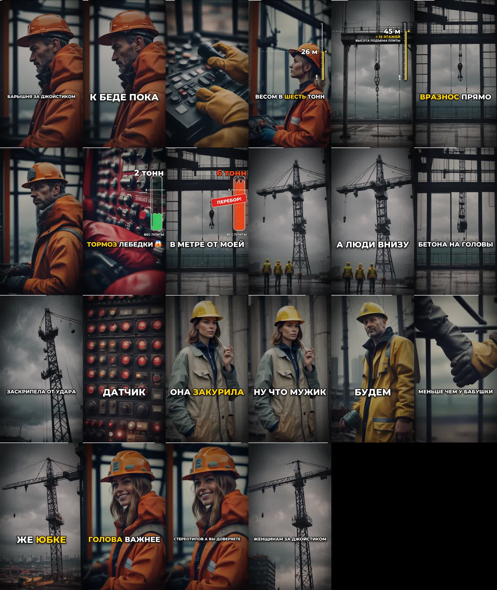
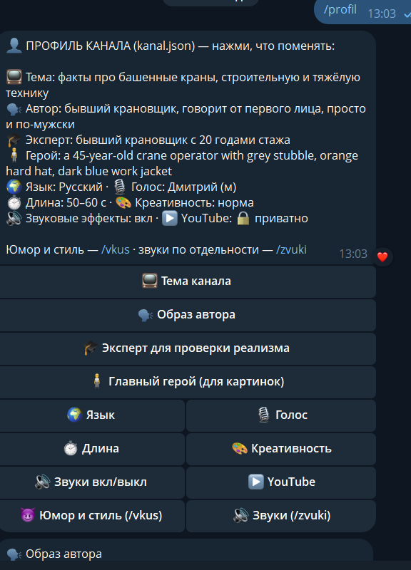
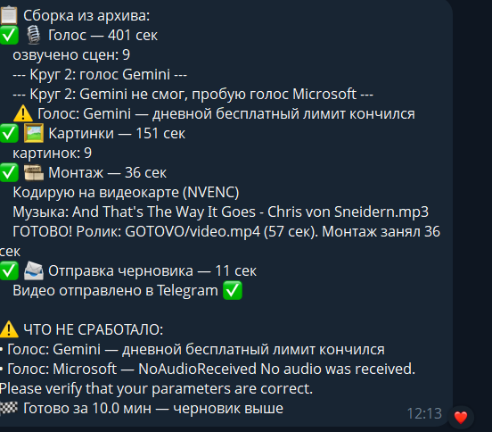
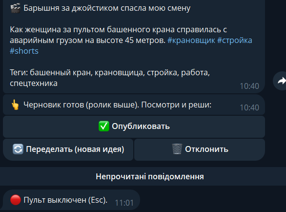

# Hi, I'm Dima 👋

**Telegram bots & AI automation developer** — Python · Claude API · Gemini · Telegram Bot API · Google Sheets · GitHub Actions.

I build small AI systems that do real work on their own: find, evaluate, create and deliver — and report to Telegram, where a human makes the final decision.

🇷🇺 [Русская версия ниже](#-по-русски)

> Source code of these projects is private. A live demo or a code walkthrough is available on request.

---

## 🎯 Ohotnik — AI Freelance Order Hunter

**Problem:** good freelance jobs disappear in hours; checking several platforms by hand eats the day.
**Solution:** an agent that collects new jobs, scores each one with an LLM against my skills, and sends the best to Telegram with a ready proposal draft.

| Job alert: AI score + proposal draft | Weekly report | Upwork saved searches |
|---|---|---|
|  |  |  |

- Runs 24/7 in the cloud (GitHub Actions cron) + a Telegram control panel on the laptop
- Claude Haiku scores each job 0–100: skills match, hours, budget, price, risks, proposal draft
- Google Sheets as shared memory: jobs, statuses, AI spend, weekly stats
- **~$0.0006 per evaluated job**, monthly AI budget cap, retries, plain-language error alerts
- Ethical by design: public RSS only, no login bypass, no auto-applying

**Stack:** Python · Claude API · Telegram Bot API · Google Sheets API · GitHub Actions · RSS

---

## 🎬 YouTube Shorts Factory — from idea to video, controlled from Telegram

**Problem:** making short videos means writing, voicing, finding images, editing — hours per video.
**Solution:** one command `/video` in Telegram → a few minutes later a finished draft arrives → **Publish / Redo / Reject**. The system learns from the author's ratings.

 &nbsp; 

| Channel profile `/profil` | Build report | Draft with decision buttons |
|---|---|---|
|  |  |  |

- **5 AI agents** in a row: brainstorm → script → editor → virality checker → story checker
- Voice with 3 fallbacks (Edge TTS → Gemini TTS → offline Piper), word-level subtitles (Whisper)
- Images: Cloudflare FLUX → **local GPU generation** (SDXL-Lightning) → stock photos
- Editing: motion-graphics templates synced to the narrator, sound design, −14 LUFS, NVENC
- **0 € per month** — free tiers and local models only; resumes from the failed step

**Stack:** Python · Gemini API · FFmpeg · Diffusers (CUDA) · faster-whisper · Freesound API · YouTube Data API · Telegram Bot API

---

## 🛠 Coming next

**Salon assistant bot** — a Telegram administrator for a hair salon: answers clients about services and prices, and hands the conversation to the owner when it can't help. *In progress.*

---

## 📬 Contact

Open to small automation projects: Telegram bots, AI assistants, parsers and integrations (Google Sheets, APIs).
Write to me via GitHub or Telegram (link on request).

---

## 🇷🇺 По-русски

Меня зовут Дима. Делаю **Telegram-ботов и AI-автоматизацию** на Python: системы, которые сами ищут, оценивают, создают и присылают результат в Telegram, а решение принимает человек.

- **Охотник за заказами** — собирает заказы с фриланс-бирж, оценивает их через Claude под мои навыки и присылает лучшие в Telegram с готовым откликом. Работает 24/7 в облаке, ~$0.0006 за оценку заказа.
- **Фабрика YouTube Shorts** — команда `/video` в Telegram → через несколько минут готовый ролик: сценарий, озвучка, картинки на своей видеокарте, монтаж, звук. 0 € в месяц.
- **Скоро:** бот-администратор салона красоты.

Код проектов закрыт — покажу демо или разберу код по запросу.
